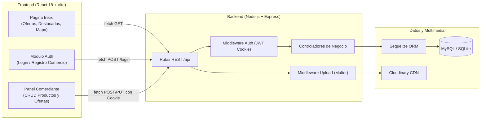
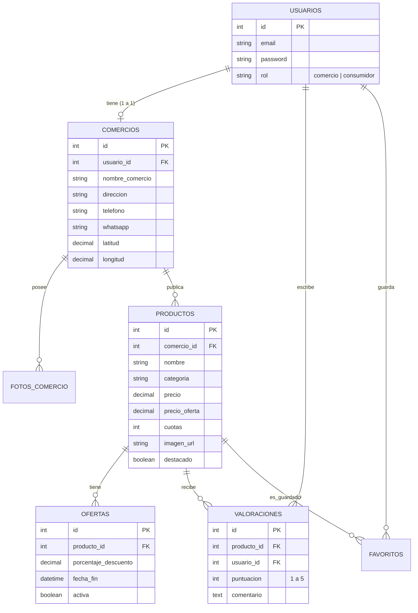

# 🎓 Guía Definitiva de Arquitectura, Exposición Oral e Integración: SpotMarket

**Proyecto:** SpotMarket — Plataforma de Descubrimiento de Comercios y Productos de Barrio  
**Institución:** Instituto Politécnico Formosa — Tecnicatura Superior en Desarrollo de Software  
**Cátedra:** Prácticas Profesionalizantes / Programación Web (Prof. Agustín Centurión)  
**Equipo:** Aguirre Ana, Bogado Daiana, Duarte Serena, Schibilbain Valentina  

---

## 📑 Tabla de Contenidos
1. [Resumen Ejecutivo del Proyecto](#1-resumen-ejecutivo-del-proyecto)
2. [Reglas de Negocio Clave (Alcance y Delimitación)](#2-reglas-de-negocio-clave-alcance-y-delimitación)
3. [Arquitectura Técnica Integral](#3-arquitectura-técnica-integral)
4. [Ecosistema de Base de Datos (Sequelize + MySQL / SQLite)](#4-ecosistema-de-base-de-datos-sequelize--mysql--sqlite)
5. [Gestión Multimedia con Cloudinary](#5-gestión-multimedia-con-cloudinary)
6. [Seguridad y Autenticación (JWT + HttpOnly Cookies)](#6-seguridad-y-autenticación-jwt--httponly-cookies)
7. [Módulo Comerciante Desacoplado y Guía de Integración](#7-módulo-comerciante-desacoplado-y-guía-de-integración)
8. [Guion de Defensa Oral (20 Minutos - 4 Integrantes)](#8-guion-de-defensa-oral-20-minutos---4-integrantes)
9. [Preguntas Típicas de la Mesa Examinadora y Respuestas Modelo](#9-preguntas-típicas-de-la-mesa-examinadora-y-respuestas-modelo)

---

## 1. Resumen Ejecutivo del Proyecto

**SpotMarket** es una aplicación web full-stack diseñada para conectar a los vecinos de la ciudad de **Formosa Capital** con los comercios de cercanía (almacenes, fruterías, ferreterías, tiendas de tecnología y deportes).

A diferencia de un e-commerce tradicional de venta minorista global, SpotMarket es una **plataforma de descubrimiento y visibilización de precios locales**, donde los comerciantes publican sus ofertas, catálogo y facilidades de pago (cuotas sin interés), permitiendo que el consumidor ubique el negocio en el mapa interactivo y concrete la compra de forma presencial o directa a través de WhatsApp.



---

## 2. Reglas de Negocio Clave (Alcance y Delimitación)

Durante la presentación final, es fundamental justificar por qué se omitieron ciertas complejidades innecesarias para enfocar el esfuerzo en la calidad y robustez pedagógica:

1. **Sin Carrito de Compras ni Pedidos:** No se procesan pagos ni transacciones en la app. El objetivo es incentivar el comercio de barrio y el contacto directo comerciante-vecino vía WhatsApp o mostrador.
2. **Sin Manejo de Stock:** Los comercios de barrio actualizan precios y catálogo; la existencia física se coordina directamente por WhatsApp, evitando inconsistencias de stock en tiempo real que requieren sincronización con puntos de venta físicos (POS).
3. **Sin Regateo ni Negociación:** Los precios son transparentes y fijos (precio regular y precio de oferta).
4. **Sin Chat Interno:** Se sustituye un sistema de chat complejo por un enlace directo y rápido a la API de WhatsApp (`https://wa.me/...`), garantizando que el comerciante reciba las consultas de inmediato en su teléfono celular.
5. **Sin Directorio Público de Usuarios:** Se respeta la privacidad de los vecinos; los usuarios no tienen perfiles públicos ni pueden ser visualizados por terceros.
6. **Sin Calificaciones de Comercios (Solo Calificación de Productos):** Para evitar difamaciones o competencia desleal entre comercios barriales, los comercios no reciben calificaciones globales; la comunidad califica exclusivamente la calidad de los productos concretos (1 a 5 estrellas y opiniones).
7. **Página de Inicio Basada en Relevancia Comercial:** En lugar de "comercios mejor calificados", la pantalla principal destaca:
   - *Productos más solicitados y vendidos*
   - *Ofertas de la semana (con porcentaje de descuento)*
   - *Productos con financiación en cuotas*
   - *Últimas novedades del catálogo*
   - *Comercios de tu barrio geolocalizados*

---

## 3. Arquitectura Técnica Integral

### Estructura de Directorios del Proyecto Completo

```text
spot-market/
├── backend/
│   ├── src/
│   │   ├── config/
│   │   │   ├── db.js              # Conexión Sequelize dual (MySQL y SQLite fallback)
│   │   │   ├── cloudinary.js      # Configuración de credenciales de Cloudinary
│   │   │   └── env.js             # Variables de entorno centralizadas
│   │   ├── controllers/
│   │   │   ├── authController.js       # Registro, login con JWT y logout
│   │   │   ├── comercioController.js   # Listado público y perfil de comercios
│   │   │   ├── productoController.js   # CRUD de catálogo, filtros y destacados
│   │   │   ├── ofertaController.js     # Promociones temporales
│   │   │   ├── valoracionController.js # Calificaciones de 1-5 estrellas en productos
│   │   │   └── favoritoController.js   # Guardado de productos preferidos
│   │   ├── middlewares/
│   │   │   ├── auth.js            # Extracción y verificación de token JWT en cookie
│   │   │   ├── upload.js          # Procesamiento en memoria de archivos con Multer
│   │   │   └── validateRequest.js # Validación de esquemas con express-validator
│   │   ├── models/
│   │   │   ├── Usuario.js         # Credenciales y rol ('comercio', 'consumidor')
│   │   │   ├── Comercio.js        # Datos fiscales, teléfono, WhatsApp, latitud/longitud
│   │   │   ├── FotoComercio.js    # Fotos de fachada y local
│   │   │   ├── Producto.js        # Catálogo, precio, cuotas, imagen Cloudinary
│   │   │   ├── Oferta.js          # Descuentos porcentuales con vigencia
│   │   │   ├── Valoracion.js      # Puntuación y reseñas en productos
│   │   │   ├── Favorito.js        # Relación N:M usuario-producto
│   │   │   └── index.js           # Definición de relaciones y asociaciones Sequelize
│   │   ├── routes/                # Enrutadores REST montados en /api
│   │   ├── seed.js                # Poblado automático con 7 comercios reales de Formosa
│   │   └── utils/
│   │       ├── cloudinaryUpload.js # Pipe stream a la API de Cloudinary
│   │       ├── cookie.js           # Opciones de cookies seguras (httpOnly, sameSite)
│   │       └── haversine.js        # Cálculo de distancia geográfica en km
│   ├── app.js                     # Configuración de Express, CORS y middlewares
│   └── server.js                  # Inicialización del puerto HTTP
└── frontend/
    ├── src/
    │   ├── assets/                # Logotipos SVG de alta resolución (Logo.svg, LogoNavbar.svg)
    │   ├── components/
    │   │   ├── Navbar.jsx         # Menú con buscador reactivo, categorías y sesión
    │   │   ├── auth/              # Formularios de autenticación
    │   │   └── map/               # Componentes Leaflet para geolocalización en Formosa
    │   ├── hooks/
    │   │   ├── useFetch.js        # Custom hook con AbortController
    │   │   └── useForm.js         # Custom hook para formularios controlados
    │   ├── pages/
    │   │   ├── Inicio.jsx         # Pantalla principal con ofertas, cuotas y mapa
    │   │   ├── Productos.jsx      # Catálogo con filtros de categoría y precio
    │   │   ├── DetalleProducto.jsx# Vista ampliada, cuotas, valoraciones y botón WhatsApp
    │   │   ├── Ofertas.jsx        # Carrusel y tarjetas de promociones activas
    │   │   ├── MapaPage.jsx       # Mapa interactivo completo de Formosa Capital
    │   │   └── PanelComercio.jsx  # Administración para comerciantes
    │   ├── services/api.js        # Wrapper fetch nativo con credentials: 'include'
    │   └── index.css              # Estilos Tailwind con paleta de alto contraste
    ├── tailwind.config.js
    └── vite.config.js
```

---

## 4. Ecosistema de Base de Datos (Sequelize + MySQL / SQLite)

### Modelo Entidad-Relación



### Justificación Técnica de la Persistencia Dual:
- **En Producción / Laboratorio:** Se conecta a **MySQL 8.0** mediante el driver `mysql2`.
- **En Demostración / Evaluación:** Si el servidor MySQL local no está levantado durante la presentación, el módulo [db.js](file:///home/fernandez/spot-market/backend/src/config/db.js) detecta el fallo automáticamente y levanta **SQLite** (`./data/spotmarket.sqlite`), garantizando que la defensa **nunca se interrumpa por problemas de base de datos**.

---

## 5. Gestión Multimedia con Cloudinary

Para el almacenamiento de imágenes de productos y fotos de comercios se integró **Cloudinary**:

1. **Subida Eficiente (Stream sin disco):** Se utiliza `multer.memoryStorage()`. El archivo no se guarda en el disco del servidor, sino que se mantiene en un buffer en memoria RAM.
2. **Transformación en la Nube:** La función auxiliar `uploadStream` envía los bytes directamente a la API de Cloudinary usando streams de Node.js:
   ```javascript
   const uploadStream = (buffer, options = {}) => {
     return new Promise((resolve, reject) => {
       const stream = cloudinary.uploader.upload_stream(options, (error, result) => {
         if (error) return reject(error);
         resolve(result);
       });
       stream.end(buffer);
     });
   };
   ```
3. **Optimización Automática:** Cloudinary entrega la imagen en formato WebP optimizado y con CDN global, acelerando la carga del frontend en cualquier dispositivo.

---

## 6. Seguridad y Autenticación (JWT + HttpOnly Cookies)

El sistema de autenticación sigue las mejores prácticas enseñadas en la cátedra:

```mermaid
sequenceDiagram
    autonumber
    actor Comerciante
    participant React as Frontend React
    participant API as Backend Express
    participant DB as Base de Datos

    Comerciante->>React: Ingresa email y contraseña
    React->>API: POST /api/auth/login {email, password}
    API->>DB: Busca Usuario por email
    DB-->>API: Retorna hash bcrypt
    API->>API: Compara hash con bcryptjs.compare()
    API->>API: Firma JWT con usuario_id y rol
    API-->>React: HTTP 200 + Set-Cookie: token=JWT; HttpOnly; SameSite=Lax
    React->>React: Guarda flag isLogged=true en localStorage
    React-->>Comerciante: Redirige al Panel del Comerciante
    
    Note over React,API: Peticiones autenticadas posteriores (CRUD)
    React->>API: POST /api/productos (credentials: 'include')
    Note right of React: El navegador adjunta la cookie token automáticamente
    API->>API: Middleware auth verifica JWT
    API->>DB: Registra nuevo producto
    DB-->>API: OK
    API-->>React: HTTP 201 Created
```

### Ventajas Pedagógicas:
- **Protección contra ataques XSS:** Al guardar el token JWT en una cookie con flag `HttpOnly`, ningún script malicioso de JavaScript en el cliente puede robar el token de acceso.
- **Simplicidad en React:** No es necesario pasar cabeceras `Authorization: Bearer ...` manualmente en cada fetch; con solo configurar `credentials: 'include'`, el navegador se encarga de la gestión del token.

---

## 7. Módulo Comerciante Desacoplado y Guía de Integración

Para cumplir con el requerimiento de trabajar en equipo sin provocar conflictos de Git, se separó la vista del comerciante y la autenticación en el repositorio:
📁 `/home/fernandez/spotmarket-modulo-comerciante`

### Pasos para unificarlo a otro proyecto:
1. Copiar la carpeta `src/components/auth/` y `src/components/comerciante/`.
2. Copiar los hooks `useForm.js` y `useFetch.js`.
3. Asegurar que las peticiones en `src/services/api.js` apunten al backend (`http://localhost:4000/api`) con `credentials: 'include'`.
4. Importar el componente `PanelPage` o los submódulos (`GestionProductos`, `GestionOfertas`, `PerfilComercio`) según el enrutamiento del proyecto receptor.

---

## 8. Guion de Defensa Oral (20 Minutos - 4 Integrantes)

### Estructura del Tiempo (5 minutos por integrante)

| Integrante | Rol Temático | Contenido a Defender |
| :--- | :--- | :--- |
| **Integrante 1 (5 min)** | Introducción & Negocio | Problema que resuelve SpotMarket, delimitación de alcance (por qué sin pedidos ni chat), impacto local en Formosa. |
| **Integrante 2 (5 min)** | Frontend & Experiencia | Arquitectura de componentes React, Vite, Tailwind de alto contraste, mapas interactivos con Leaflet, hooks `useFetch` y `useForm`. |
| **Integrante 3 (5 min)** | Backend & Seguridad | Arquitectura Express, autenticación JWT con Cookies `HttpOnly`, middlewares de validación y control de errores centralizado. |
| **Integrante 4 (5 min)** | Base de Datos & Demo en Vivo | Modelado en Sequelize, dualidad MySQL/SQLite, Cloudinary, y demostración en vivo del alta de un producto y visualización en el inicio. |

---

### Guion Detallado Paso a Paso

#### Minuto 0:00 - 5:00 — Integrante 1: Justificación del Proyecto y Modelo de Negocio
> *"Buenas tardes, profesores y tribunal. Hoy les presentamos **SpotMarket**, una plataforma web diseñada específicamente para dinamizar la economía de cercanía en Formosa Capital.*  
>  
> *Muchos pequeños comerciantes de barrio —como verdulerías, ferreterías o casas de repuestos— no cuentan con plataformas accesibles para mostrar sus precios, ofertas y facilidades de pago en cuotas. Por su parte, los vecinos caminan buscando precios o dependen de grupos informales.*  
>  
> *Al analizar el problema, tomamos una decisión de arquitectura clave: **SpotMarket no es un e-commerce cerrado con carrito ni pasarelas de pago engorrosas**. En el comercio barrial, el vecino quiere ver el precio, saber si hay cuotas, ubicar el local en el mapa de su barrio y comunicarse al instante. Por eso reemplazamos el chat interno y los carritos por un enlace directo y verificado a WhatsApp y la ubicación exacta en el mapa.*  
>  
> *Además, para proteger el comercio justo y evitar el desprestigio malintencionado entre competidores del mismo rubro, los comercios no reciben calificaciones como negocio; las reseñas y estrellas de 1 a 5 se asignan estrictamente a la calidad de los productos concretos."*

---

#### Minuto 5:00 - 10:00 — Integrante 2: Frontend Moderno con React, Vite y Custom Hooks
> *"En el frontend implementamos una arquitectura basada en **React 18** empaquetada con **Vite**, lo que nos brinda una experiencia de desarrollo sumamente ágil y tiempos de carga casi instantáneos.*  
>  
> *Para el diseño visual nos enfocamos en una estética oscura de **alto contraste** —con fondos en `#070C16` y acentos en amarillo `#FFB800` y rojo `#EF4444`— que prioriza la legibilidad en pantallas móviles y monitores de cualquier gama.*  
>  
> *A nivel de código, respetamos los principios pedagógicos vistos durante el cuatrimestre:*  
> *1. Desarrollamos el hook personalizado `useForm` para encapsular la gestión de formularios controlados, captura de eventos `onChange` y validación de campos obligatorios.*  
> *2. Desarrollamos el hook `useFetch`, que maneja de forma declarativa el estado de carga (`loading`), los datos recibidos y los errores, incorporando además `AbortController` para cancelar peticiones pendientes cuando un componente se desmonta, evitando fugas de memoria.*  
>  
> *En la pantalla de inicio, reemplazamos la vista estática por secciones orientadas a la conversión:*  
> *- **Ofertas de la semana**, calculando el porcentaje de ahorro real.*  
> *- **Productos en cuotas sin interés**, una necesidad fundamental de los consumidores locales.*  
> *- **Mapa interactivo de Formosa**, desarrollado con Leaflet y React-Leaflet, que muestra los comercios georreferenciados en barrios como San Martín, Don Bosco, San Francisco o Fontana."*

---

#### Minuto 10:00 - 15:00 — Integrante 3: Backend RESTful, Seguridad JWT y Middlewares
> *"El backend está construido sobre **Node.js y Express**, siguiendo el patrón arquitectónico Controlador-Ruta-Modelo.*  
>  
> *La seguridad del sistema se diseñó bajo estándares de la industria:*  
> *- Las contraseñas de comerciantes y usuarios nunca se guardan en texto plano; son procesadas con **bcryptjs** mediante un factor de costo de 10 rondas de hashing y salting.*  
> *- Para la sesión utilizamos **JSON Web Tokens (JWT)**. A diferencia de implementaciones que guardan el token en `localStorage` —exponiéndolo a ataques de Cross-Site Scripting (XSS)—, en SpotMarket el token se envía en una cookie con la directiva **HttpOnly** y **SameSite=Lax**.*  
>  
> *Esto significa que el navegador administra la cookie de forma nativa. En el frontend simplemente configuramos `credentials: 'include'` en el cliente nativo de `fetch`, y en cada petición el middleware `auth.js` verifica la firma criptográfica del token, extrayendo el ID del usuario y su rol.*  
>  
> *Asimismo, centralizamos el manejo de errores en un middleware global y protegemos las rutas con validadores declarativos de `express-validator` para asegurar que ningún dato inválido llegue a la base de datos."*

---

#### Minuto 15:00 - 20:00 — Integrante 4: Sequelize, Cloudinary y Demostración en Vivo
> *"Para la capa de persistencia utilizamos el ORM **Sequelize**. Diseñamos un modelo relacional limpio que incluye Comercios, Productos, Ofertas temporales, Valoraciones y Favoritos.*  
>  
> *Un aspecto diferencial de nuestro backend es la **resiliencia dual**: está configurado para conectarse primariamente a **MySQL 8.0**, pero si por cualquier eventualidad el servicio de MySQL no estuviera disponible en el entorno de despliegue, el archivo de configuración realiza un fallback automático a una base embebida **SQLite**, garantizando que la aplicación continúe operando sin caídas.*  
>  
> *Para los archivos multimedia, implementamos la integración con **Cloudinary**. Cuando el comerciante sube la foto de un producto, la imagen no toca el disco del servidor: utilizamos `multer.memoryStorage()` y enviamos el buffer por stream a la nube, guardando en la base de datos únicamente la URL segura optimizada en formato WebP.*  
>  
> *(Pasa a la demostración en pantalla)*:  
> *1. Iniciamos sesión como 'Almacén Don Pepe'.*  
> *2. Vamos a 'Nuevo Producto', cargamos 'Yerba Mate Premium 1kg', indicamos precio regular de \$3.500 y oferta de \$2.800 en 3 cuotas.*  
> *3. Subimos la foto y guardamos. Vemos cómo el producto aparece al instante en el dashboard.*  
> *4. Abrimos la pantalla principal de SpotMarket: el producto ya figura en las 'Ofertas de la semana' y en 'Productos en cuotas'. Al tocar el botón de WhatsApp, se abre la conversación con el mensaje prearmado listando el producto.*  
>  
> *Con esto demostramos la integración completa entre Frontend, Backend, Base de Datos y Multimedia. Quedamos a disposición del tribunal para responder sus preguntas. Muchas gracias."*

---

## 9. Preguntas Típicas de la Mesa Examinadora y Respuestas Modelo

### Pregunta 1: *"¿Por qué decidieron no usar Axios ni librerías de estado global como Redux?"*
> **Respuesta:**  
> *"Decidimos no utilizar Axios porque la API nativa `fetch` de los navegadores modernos resuelve todas nuestras necesidades sin añadir peso innecesario al bundle final. Además, al configurar `credentials: 'include'`, el envío de cookies HttpOnly es transparente. Respecto a Redux, para el alcance de SpotMarket el estado se gestiona de forma limpia y predecible mediante composición de componentes y los Custom Hooks `useFetch` y `useForm`, respetando la consigna pedagógica de mantener el código legible y sin sobreingeniería."*

### Pregunta 2: *"¿Cómo evitaron que un comerciante modifique productos de otro comercio?"*
> **Respuesta:**  
> *"En el backend, en el controlador `productoController.js`, cada vez que se ejecuta un `PUT` o `DELETE`, no solo buscamos el producto por su `id`, sino que verificamos que el `comercio_id` asociado coincida con el comercio perteneciente al `usuario_id` extraído del token JWT verificado en el middleware de autenticación. Si no coinciden, el servidor rechaza la operación inmediatamente con un código HTTP `403 Forbidden`."*

### Pregunta 3: *"¿Por qué las calificaciones son sobre productos y no sobre el comercio?"*
> **Respuesta:**  
> *"El objetivo social de SpotMarket es apoyar al comercio de barrio formoseño. Las calificaciones a nivel de comercio suelen ser subjetivas o vulnerables a sabotajes entre locales vecinos. En cambio, calificar el producto específico (su calidad, frescura o relación precio-calidad) aporta información objetiva y útil a otros consumidores sin penalizar injustamente el negocio en su totalidad."*

### Pregunta 4: *"¿Cómo funciona el cálculo de distancia en el mapa?"*
> **Respuesta:**  
> *"Implementamos la fórmula matemática del Haversine en la utilidad `haversine.js`. A partir de las coordenadas de latitud y longitud del comercio y la posición del usuario (obtenida mediante la Geolocation API del navegador), se calcula la distancia ortodrómica en kilómetros sobre la superficie esférica de la Tierra, permitiendo ordenar los comercios por cercanía."*
