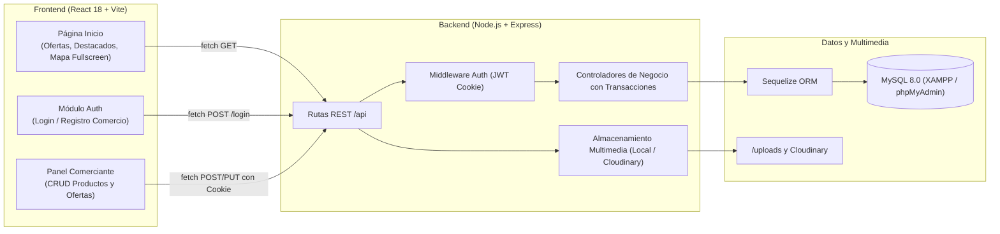

# 🎓 Guía Definitiva de Arquitectura, Exposición Oral e Integración: SpotMarket

**Proyecto:** SpotMarket — Plataforma de Descubrimiento de Comercios y Productos de Barrio  
**Institución:** Instituto Politécnico Formosa — Tecnicatura Superior en Desarrollo de Software  
**Cátedra:** Prácticas Profesionalizantes / Programación Web (Prof. Agustín Centurión)  
**Equipo:** Aguirre Ana, Bogado Daiana, Duarte Serena, Schibilbain Valentina  

---

## 📑 Tabla de Contenidos
1. [Resumen Ejecutivo del Proyecto](#1-resumen-ejecutivo-del-proyecto)
2. [Reglas de Negocio Clave (Alcance y Delimitación)](#2-reglas-de-negocio-clave-alcance-y-delimitación)
3. [Tipos de Comercio y Categorías de Productos](#3-tipos-de-comercio-y-categorías-de-productos)
4. [Arquitectura Técnica Integral](#4-arquitectura-técnica-integral)
5. [Ecosistema de Base de Datos (MySQL / phpMyAdmin con XAMPP)](#5-ecosistema-de-base-de-datos-mysql--phpmyadmin-con-xampp)
6. [Gestión Multimedia (Almacenamiento Local + Cloudinary)](#6-gestión-multimedia-almacenamiento-local--cloudinary)
7. [Seguridad y Autenticación (JWT + HttpOnly Cookies + Transacciones Atómicas)](#7-seguridad-y-autenticación-jwt--httponly-cookies--transacciones-atómicas)
8. [Módulo Comerciante Desacoplado y Guía de Integración](#8-módulo-comerciante-desacoplado-y-guía-de-integración)
9. [Guion de Defensa Oral (20 Minutos - 4 Integrantes)](#9-guion-de-defensa-oral-20-minutos---4-integrantes)
10. [Preguntas Típicas de la Mesa Examinadora y Respuestas Modelo](#10-preguntas-típicas-de-la-mesa-examinadora-y-respuestas-modelo)

---

## 1. Resumen Ejecutivo del Proyecto

**SpotMarket** es una aplicación web full-stack diseñada para conectar a los vecinos de la ciudad de **Formosa Capital** con los comercios de cercanía (almacenes, fruterías, carnicerías, ferreterías, tiendas de calzado y más).

A diferencia de un e-commerce tradicional de venta minorista global, SpotMarket es una **plataforma de descubrimiento y visibilización de precios locales**, donde los comerciantes publican sus ofertas, catálogo y facilidades de pago (cuotas sin interés), permitiendo que el consumidor ubique el negocio en el mapa interactivo y concrete la compra de forma presencial o directa a través de WhatsApp.



---

## 2. Reglas de Negocio Clave (Alcance y Delimitación)

Durante la presentación final, es fundamental justificar por qué se omitieron ciertas complejidades innecesarias para enfocar el esfuerzo en la calidad y robustez pedagógica:

1. **Sin Carrito de Compras ni Pedidos:** No se procesan pagos ni transacciones en la app. El objetivo es incentivar el comercio de barrio y el contacto directo comerciante-vecino vía WhatsApp o mostrador.
2. **Sin Manejo de Stock:** Los comercios de barrio actualizan precios y catálogo; la existencia física se coordina directamente por WhatsApp, evitando inconsistencias de stock en tiempo real que requieren sincronización con puntos de venta físicos (POS).
3. **Sin Regateo ni Negociación:** Los precios son transparentes y fijos (precio regular y precio de oferta con financiación en cuotas).
4. **Sin Chat Interno:** Se sustituye un sistema de chat complejo por un enlace directo y verificado a la API de WhatsApp (`https://wa.me/...`), garantizando que el comerciante reciba las consultas de inmediato en su teléfono celular.
5. **Sin Directorio Público de Usuarios:** Se respeta la privacidad de los vecinos; los usuarios no tienen perfiles públicos ni pueden ser visualizados por terceros.
6. **Sin Calificaciones de Comercios (Solo Calificación de Productos):** Para evitar difamaciones o competencia desleal entre comercios barriales, los comercios no reciben calificaciones globales; la comunidad califica exclusivamente la calidad de los productos concretos (1 a 5 estrellas y opiniones).
7. **Página de Inicio Basada en Relevancia Comercial:** En lugar de "comercios mejor calificados", la pantalla principal destaca:
   - *Productos más solicitados y vendidos (Destacados)*
   - *Ofertas de la semana (con porcentaje de ahorro real)*
   - *Productos con financiación en cuotas sin interés*
   - *Últimas novedades del catálogo*
   - *Comercios de tu barrio geolocalizados con opción de Agrandar Pantalla Completa*

---

## 3. Tipos de Comercio y Categorías de Productos

### Tipos de Comercio
El sistema clasifica los comercios en dos modalidades oficiales:
- **Minorista:** Comercios orientados a la venta directa al consumidor final (vecinos).
- **Mayorista:** Comercios y distribuidoras barriales para compras por volumen o reventa.

### Categoría de Productos (27 opciones oficiales en orden alfabético)
Tanto en el registro de comercio, como en el panel de carga de productos y en los filtros de búsqueda del catálogo, se utiliza estrictamente el listado alfabético:
1. **Almacén**
2. **Artesanías**
3. **Artículos de limpieza**
4. **Bazar**
5. **Bebidas**
6. **Carnicería**
7. **Embutidos**
8. **Farmacias**
9. **Ferretería**
10. **Fiambrería**
11. **Forrajería / Pet Shop**
12. **Frutería**
13. **Juguetería**
14. **Kiosco**
15. **Lácteos**
16. **Librería**
17. **Maxikiosco**
18. **Mueblería**
19. **Panadería**
20. **Pescadería**
21. **Polirubro**
22. **Pollería**
23. **Regalería**
24. **Ropería**
25. **Verdulería**
26. **Vivero**
27. **Zapatería**

---

## 4. Arquitectura Técnica Integral

### Estructura de Directorios del Proyecto Completo

```text
spot-market/
├── backend/
│   ├── .env                       # Configuración estándar lista para XAMPP / MySQL
│   ├── .env.example
│   ├── uploads/                   # Carpeta estática donde se sirven las fotos subidas
│   ├── src/
│   │   ├── config/
│   │   │   ├── db.js              # Conexión Sequelize a MySQL con auto-creación de base de datos
│   │   │   ├── env.js             # Lector de variables de entorno .env
│   │   │   └── cloudinary.js      # Configuración de credenciales de Cloudinary
│   │   ├── controllers/
│   │   │   ├── authController.js       # Registro con transacción atómica, login JWT y logout
│   │   │   ├── comercioController.js   # Listado público y perfil de comercios
│   │   │   ├── productoController.js   # CRUD de catálogo, filtros y destacados con guardado de fotos
│   │   │   ├── ofertaController.js     # Promociones temporales
│   │   │   ├── valoracionController.js # Calificaciones de 1-5 estrellas en productos
│   │   │   └── favoritoController.js   # Guardado de productos preferidos
│   │   ├── middlewares/
│   │   │   ├── auth.js            # Extracción y verificación de token JWT en cookie
│   │   │   ├── upload.js          # Multer memoryStorage para subida de imágenes
│   │   │   └── validateRequest.js # Validación de esquemas con express-validator
│   │   ├── models/
│   │   │   ├── Usuario.js         # Credenciales y rol ('comerciante', 'usuario')
│   │   │   ├── Comercio.js        # Tipo de comercio ('minorista'/'mayorista'), categorías, lat/lng
│   │   │   ├── FotoComercio.js    # Fotos de fachada y salón de ventas
│   │   │   ├── Producto.js        # Catálogo, precio, cuotas, imagen
│   │   │   ├── Oferta.js          # Descuentos porcentuales con vigencia
│   │   │   ├── Valoracion.js      # Puntuación y reseñas en productos
│   │   │   └── Favorito.js        # Relación N:M usuario-producto
│   │   ├── seed.js                # Poblado con 7 comercios y 17 productos con categorías A-Z
│   │   └── utils/
│   │       ├── imageStorage.js    # Gestor dual de imágenes (Local /uploads + Cloudinary)
│   │       ├── cookie.js          # Opciones de cookies seguras (httpOnly, sameSite)
│   │       └── haversine.js       # Cálculo de distancia geográfica en km
│   ├── app.js                     # Configuración de Express, CORS y servicio estático /uploads
│   └── server.js                  # Inicialización del puerto HTTP
└── frontend/
    ├── src/
    │   ├── constants/
    │   │   └── categorias.js      # Tipos de comercio y 27 categorías oficiales A-Z
    │   ├── utils/
    │   │   └── imageUrl.js        # Normalizador de URLs locales y de nube
    │   ├── components/
    │   │   └── Navbar.jsx         # Menú con buscador reactivo, categorías y sesión
    │   ├── pages/
    │   │   ├── Inicio.jsx         # Pantalla principal con mapa Leaflet y botón Agrandar Pantalla
    │   │   ├── Productos.jsx      # Catálogo con selector de 27 categorías A-Z
    │   │   ├── DetalleProducto.jsx# Vista ampliada, cuotas, valoraciones y botón WhatsApp
    │   │   ├── MapaPage.jsx       # Mapa interactivo con soporte de pantalla completa
    │   │   ├── RegisterComercio.jsx # Alta en 3 secciones con previsualización de fotos y mapa fullscreen
    │   │   └── PanelComercio.jsx  # Administración para comerciantes con subida de fotos y preview
    │   └── services/api.js        # Cliente fetch nativo con credentials: 'include'
    ├── tailwind.config.js
    └── vite.config.js
```

---

## 5. Ecosistema de Base de Datos (MySQL / phpMyAdmin con XAMPP)

El proyecto está configurado para operar de forma nativa con **MySQL** en el puerto `3306` (el estándar de XAMPP):

1. **Archivo `.env` transparente:**
   ```env
   DB_DIALECT=mysql
   DB_HOST=127.0.0.1
   DB_PORT=3306
   DB_USER=root
   DB_PASSWORD=
   DB_NAME=spotmarket
   ```
2. **Auto-creación de Base de Datos:** Al iniciar el servidor, el helper `asegurarBaseDeDatosMySQL()` ejecuta la consulta SQL `CREATE DATABASE IF NOT EXISTS spotmarket CHARACTER SET utf8mb4 COLLATE utf8mb4_unicode_ci;`, por lo que no es necesario crear manualmente la base de datos en phpMyAdmin.
3. **Sincronización:** Sequelize sincroniza automáticamente las tablas `usuarios`, `comercios`, `fotos_comercios`, `productos`, `ofertas` y `valoraciones`.

---

## 6. Gestión Multimedia (Almacenamiento Local + Cloudinary)

Para evitar que las fotos no se vean o que el registro falle por caídas de internet o falta de credenciales de Cloudinary, se implementó el módulo [imageStorage.js](file:///home/fernandez/spot-market/backend/src/utils/imageStorage.js):

1. **Previsualización en Cliente:** En el momento en que el comerciante selecciona las fotos, `URL.createObjectURL(file)` muestra la miniatura al instante antes de enviar el formulario.
2. **Guardado Seguro:**
   - Si en `.env` están configuradas las claves de Cloudinary, la imagen se sube a la CDN en la nube.
   - Si no están configuradas las claves o si no hay conexión a internet, la imagen se guarda de inmediato en la carpeta `backend/uploads/comercios/` o `backend/uploads/productos/`.
3. **Servidor Estático:** Express sirve la ruta `/uploads` de modo que las fotos locales son accesibles inmediatamente desde el navegador (`http://localhost:4000/uploads/...`), garantizando que **todas las fotos se vean siempre**.

---

## 7. Seguridad y Autenticación (JWT + HttpOnly Cookies + Transacciones Atómicas)

### Prevención del Error de Registro y "Correo ya registrado"
En el controlador [authController.js](file:///home/fernandez/spot-market/backend/src/controllers/authController.js), el alta del comercio se ejecuta dentro de una **transacción atómica de Sequelize** (`sequelize.transaction()`):
- Si ocurre algún error durante la carga de fotos o datos del local, se ejecuta automáticamente un `await t.rollback()`.
- Esto garantiza que **nunca se cree un usuario huérfano** con el correo bloqueado, permitiendo al usuario corregir sus datos y volver a intentar de inmediato.

---

## 8. Módulo Comerciante Desacoplado y Guía de Integración

El repositorio independiente `/home/fernandez/spotmarket-modulo-comerciante` cuenta con:
- `RegisterComercioForm`: Con tipo de comercio (Minorista / Mayorista), las 27 categorías de productos A-Z, mapa interactivo y previsualización de fotos.
- `GestionProductos`: CRUD de catálogo con selector de categorías y carga de imágenes.
- `PerfilComercio`: Canales de contacto y dirección física.
- `GUIA_INTEGRACION.md`: Manual paso a paso para integrarlo en cualquier proyecto del equipo.

---

## 9. Guion de Defensa Oral (20 Minutos - 4 Integrantes)

### Estructura del Tiempo (5 minutos por integrante)

| Integrante | Rol Temático | Contenido a Defender |
| :--- | :--- | :--- |
| **Integrante 1 (5 min)** | Introducción & Negocio | Problema que resuelve SpotMarket, delimitación de alcance (por qué sin pedidos ni chat), minoristas vs mayoristas, impacto local en Formosa. |
| **Integrante 2 (5 min)** | Frontend & Experiencia | Arquitectura React 18 + Vite, Tailwind de alto contraste, mapa interactivo con opción de Pantalla Completa, selector de 27 categorías A-Z y previsualización de fotos. |
| **Integrante 3 (5 min)** | Backend & Seguridad | Arquitectura Express, autenticación JWT con Cookies `HttpOnly`, transacciones atómicas de Sequelize para prevenir fallos en registro y middlewares de validación. |
| **Integrante 4 (5 min)** | Base de Datos & Demo en Vivo | Conexión con MySQL en XAMPP / phpMyAdmin, servidor de archivos multimedia estáticos `/uploads` + Cloudinary, y demostración en vivo (alta de producto, visualización en pantalla principal y botón WhatsApp). |

---

## 10. Preguntas Típicas de la Mesa Examinadora y Respuestas Modelo

### Pregunta 1: *"¿Por qué usan MySQL y cómo gestionaron la conexión en el proyecto?"*
> **Respuesta:**  
> *"Utilizamos MySQL 8.0 a través de Sequelize ORM y el driver `mysql2`. Todas las credenciales se administran mediante un archivo estándar `.env` compatible con el entorno XAMPP y phpMyAdmin. Además, implementamos una rutina que verifica y crea automáticamente la base de datos `spotmarket` si no existe, garantizando que el servidor levante sin errores de configuración."*

### Pregunta 2: *"¿Por qué dividieron los comercios en Minorista y Mayorista?"*
> **Respuesta:**  
> *"Porque en la economía barrial de Formosa conviven el pequeño almacén que vende por unidad al vecino y las distribuidoras o comercios mayoristas que ofrecen precios diferenciales por bulto o cantidad. Permitir esta distinción clarifica las expectativas de compra del consumidor."*

### Pregunta 3: *"¿Cómo aseguran que las fotos se visualicen si no hay conexión a internet para Cloudinary?"*
> **Respuesta:**  
> *"Diseñamos un gestor híbrido en `imageStorage.js`. Si las credenciales de Cloudinary están presentes y hay conexión, utiliza la nube; de lo contrario, almacena el archivo en la carpeta local `/uploads/` del servidor y Express la sirve como estático. Así garantizamos que las imágenes siempre se muestren tanto en desarrollo local como en la nube."*

### Pregunta 4: *"¿Cómo evitaron que un error en el registro deje el correo bloqueado?"*
> **Respuesta:**  
> *"Implementamos transacciones atómicas con Sequelize (`sequelize.transaction`). Toda la operación (creación del usuario, registro del comercio y asociación de fotos) se ejecuta como una sola unidad indivisible. Si cualquier paso falla, se ejecuta un rollback completo y la base de datos regresa a su estado previo sin dejar registros inconsistentes."*
